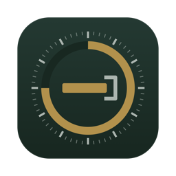
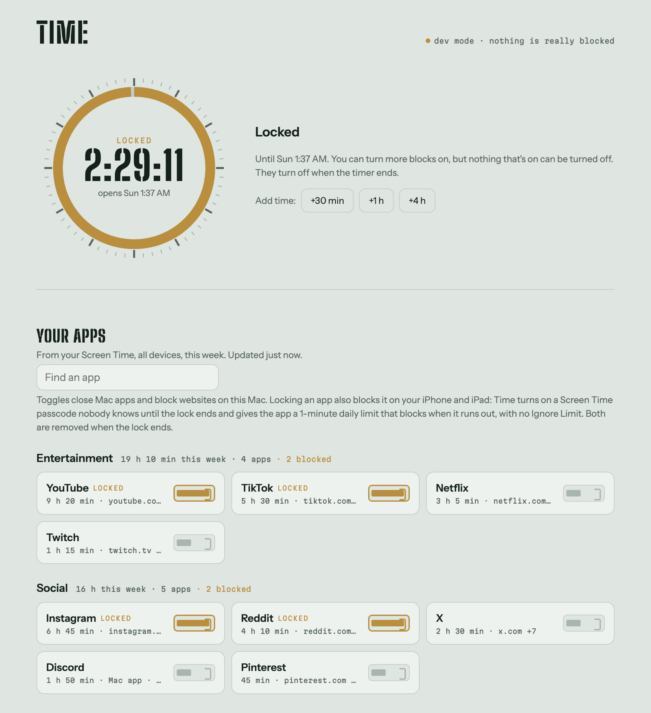

<p align="center">
  
</p>

<h1 align="center">Time</h1>

<p align="center">
  A Mac app and website blocker with a lock timer you can't click past.
</p>

<p align="center">
  <picture>
    <source media="(prefers-color-scheme: dark)" srcset="docs/screenshot-dark.png">
    
  </picture>
  <br>
  <sub>The control page during a lock (dev mode, demo apps).</sub>
</p>

## What it does

- **Toggle a block** to close that app on your Mac and block its websites in every browser.
- **Lock** the blocks that are on for up to 7 days. Until the timer ends they can't be turned off, not by restarting and not by changing the clock.
- **For your iPhone**, there's a separate [iPhone app](#iphone-app) that locks apps there with Apple's Screen Time API.
- **Hard mode** (optional, up to 72 hours) takes away your admin rights for the length of the lock.
- **Phone, Messages, and Calendar never lock**, so you can always be reached.

> [!IMPORTANT]
> Time is built to be hard to get out of, and it makes real changes to your Mac: a background service that runs as root, a hidden admin account, and your hosts file. [What Time changes on your Mac](#what-time-changes-on-your-mac) lists all of it. Try a short lock before a long one.

## Requirements

- A Mac running **macOS 13 Ventura or later**, Apple silicon or Intel. Time is developed and tested on macOS 26 Tahoe on Apple silicon.
- An **admin account**. You enter your password once, to install.
- **An internet connection** while installing. The background service downloads its own copy of Node.js.

## Install

1. **Download Time.** Get `Time-<version>.zip` from the [latest release](https://github.com/ruben-hayrapetyan/Time/releases/latest), unzip it, and drag **Time** into your Applications folder.

2. **Open Time.** Time isn't notarized by Apple, so the first time you open it macOS says it can't verify the app. Click **Done**, then go to System Settings → Privacy & Security, scroll down to the message about Time, and click **Open Anyway**. You only do this once per download.

3. **Click Install** in Time's window. macOS asks for your password once to set up the background service.

4. **That's it.** Time's window shows the control page. The blocking itself runs in the background service, so Time.app only needs to be open to change things; it also shows the lock countdown in the menu bar.

<details>
<summary>Building from source</summary>

You need **Xcode Command Line Tools** (`xcode-select --install`) and **Node.js 18 or later** with npm.

```sh
git clone https://github.com/ruben-hayrapetyan/Time.git
cd Time
./build-app.sh
```

This compiles Time.app and copies it to `/Applications`, replacing any app there already called Time. A Mac that built the app itself doesn't need **Open Anyway**. Continue from step 3.

</details>

<details>
<summary>Installing without the app</summary>

The same service installs from a terminal, from a clone of this repo:

```sh
sudo ./install.sh
```

The control page is then at **http://localhost:7777** in any browser. It's the same page Time.app shows.

</details>

## Using Time

**Blocking.** Turn an app's toggle on to block it. Time closes the Mac app whenever it opens and blocks its websites in every browser. Under **Add your own** you can block any Mac app or website. Blocking a site also blocks `www.`, `m.`, and other common versions of it.

**Locking.** Pick a length and click **Lock**. Until the timer ends, nothing that's on can be turned off. You can still turn more blocks on and add time, but you can't take time away. Blocks turn off when the timer ends unless you tick **Keep these blocks on after the timer ends**.

**Hard mode.** This is optional for each lock. It needs internet to start and lasts up to 72 hours. Your account leaves the `admin` group until the timer ends, and any open `sudo` or `su` sessions are closed. Your admin rights come back on their own when the lock ends.

**Emergency unlock.** If you really need out, type a 50-word passage by hand. Pasting is off, and it has to take at least 90 seconds. Then wait 20 more minutes with the blocks still on. You can cancel at any point and stay locked. Pick **Everything** to end the whole lock, or one locked app to unlock only that app while the rest stays locked until the timer ends.

## How the lock resists being bypassed

1. **No off switch.** While a lock runs, the page and the service both refuse to turn locked blocks off. The lock survives restarts.
2. **Self-protection.** A root service and a watchdog each reload the other if it's stopped, restoring deleted launchd files from a backup. `/etc/hosts` edits get reverted within seconds, and the program files are marked immutable (`chflags schg`).
3. **Clock-proof timer.** The timer gets its time from the [drand](https://drand.love) beacon network (with HTTPS `Date` headers as a fallback) instead of the system clock. Setting the clock forward does nothing. When offline, time only counts while the Mac is awake, so an offline lock can run long but never short.
4. **Emergency unlock only.** The one early way out is the slow, typed emergency unlock described above.
5. **Hard mode.** Without admin rights you can't stop the service or edit its files. A hidden `timekeeper` admin account stays on the Mac as a fallback. Its password is random and [time-lock encrypted](https://github.com/drand/tlock) to the lock's end time, so nobody can read it until then. The service restores your admin rights when the timer ends or the emergency unlock finishes.

**Honest limits.** On your own Mac, determined effort always wins: Recovery Mode, resetting your password through your Apple Account, or (outside hard mode) `sudo` plus enough patience. The goal is to make every way out slower and more deliberate than waiting.

## Updating

Download the newest zip from [Releases](https://github.com/ruben-hayrapetyan/Time/releases/latest), quit Time, and replace the Time in Applications with the new one. Open it (with **Open Anyway** again if macOS asks) and click **Update**. You can update while a lock is running: the lock carries over, with blocks off for a few seconds while the service restarts. Only a hard mode lock makes an update wait until it ends.

If you built from source, run `git pull` and `./build-app.sh` instead, then click **Update**.

## Uninstalling

In Time's menu, choose **Time → Uninstall Background Service…**, then drag Time.app to the Trash. From a terminal, run `sudo ./uninstall.sh`. Neither works while a lock is running.

## What Time changes on your Mac

| What | Where | Why |
| --- | --- | --- |
| A background service and a watchdog, run as root | `/Library/LaunchDaemons/com.time.blocker.plist`<br>`/Library/LaunchDaemons/com.time.watchdog.plist` | Enforce blocks and the lock; start at boot |
| Program files, a private copy of Node.js, lock state | `/Library/Application Support/Time` | Marked immutable so they can't be deleted in passing |
| Website blocks | A marked section at the end of `/etc/hosts` | Rewritten every few seconds while blocks are on |
| A hidden admin account, `timekeeper` | Users & Groups (hidden) | Hard mode's fallback admin, with a random, time-locked password |
| Logs | `/Library/Logs/Time.log` | For tracing problems |

The uninstaller removes the service, the program files, the hosts section, and the `timekeeper` account, and makes sure your account is an admin. The log files stay.

**Network and privacy.** Time has no accounts and no analytics, and your app list never leaves your Mac. It connects to:

- the drand beacon network (`api.drand.sh`, `api2.drand.sh`, `drand.cloudflare.com`), for trusted time and time-lock encryption
- `apple.com` and `google.com`, only to read the time from their `Date` header when drand can't be reached
- `nodejs.org`, once, during install
- Google Fonts, for the control page's typefaces

## If something goes wrong

**A blocked website still loads.** Browsers keep their own DNS cache. Quit the browser completely and reopen it.

**The service broke while you were in hard mode, or a Screen Time passcode was left behind** (versions before 3.0 set one during locks; the control page shows a leftover one once no lock is running). Once the lock's end time has passed, run:

```sh
"/Library/Application Support/Time/bin/node" "/Library/Application Support/Time/src/recover.js"
```

It prints the `timekeeper` password, the command that makes you an admin again, and any Screen Time passcode Time set. A leftover Screen Time passcode can also be reset with your Apple Account: choose **Forgot Passcode?** when System Settings asks for it.

**Anything else.** Check `/Library/Logs/Time.log`.

## iPhone app

`ios/` holds a separate Time app for iPhone that blocks apps with Apple's Screen Time API. It runs its own locks, separate from the Mac's:

- Pick apps, categories, or websites with Apple's picker, choose 15 minutes to 7 days, and hold the button to lock. Locked apps show a shield instead of opening.
- While a lock runs, apps can't be deleted and the clock has to stay on automatic. You can add apps and time, not remove them. The lock ends on time even with the app closed.
- The emergency unlock works like the Mac's: a 50-word passage typed by hand (no pasting, at least 90 seconds), then 20 minutes, for everything or one item.

**Honest limit:** iOS lets you turn off Time's Screen Time access in Settings with Face ID, which drops the locks. Apple doesn't let an app block that on your own phone.

To build it you need Xcode, an Apple Developer account signed in under Xcode → Settings → Accounts, and an iPhone on iOS 17 or later with Developer Mode on. `brew install xcodegen`, then in `ios/` run `xcodegen` and open `TimePhone.xcodeproj`, or build and install from a terminal:

```sh
cd ios && xcodegen
xcodebuild -scheme Time -destination 'platform=iOS,id=<your iPhone UDID>' -derivedDataPath build -allowProvisioningUpdates -allowProvisioningDeviceRegistration build
xcrun devicectl device install app --device <UDID> build/Build/Products/Debug-iphoneos/Time.app
```

To ship to TestFlight and the App Store, run `ios/release.sh`: it archives the app and uploads it to App Store Connect. That needs Apple's approval of the Family Controls distribution entitlement for the app and both extensions first. The privacy policy for the listing is [docs/privacy.md](docs/privacy.md).

## Development

```sh
npm install
npm run dev   # http://localhost:7778, dry run: nothing is closed, hosts goes to .dev-state/
```

`./build-app.sh --no-install` builds into `build/` without touching `/Applications`. `./build-app.sh --release` builds for both Apple silicon and Intel and writes `build/Time-<version>.zip` for a GitHub release.

| Path | What's there |
| --- | --- |
| `app/` | Time.app in Swift: the window, menu bar countdown, and installer |
| `src/` | The background service in Node.js: blocking, the lock timer, hard mode, recovery |
| `ui/` | The control page |
| `install.sh`, `uninstall.sh` | Set up and remove the background service |
| `build-app.sh` | Builds Time.app with the service bundled inside |
| `ios/` | The iPhone app (SwiftUI, with its Screen Time monitor and shield extensions) |

## License

[MIT](LICENSE)
