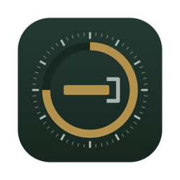
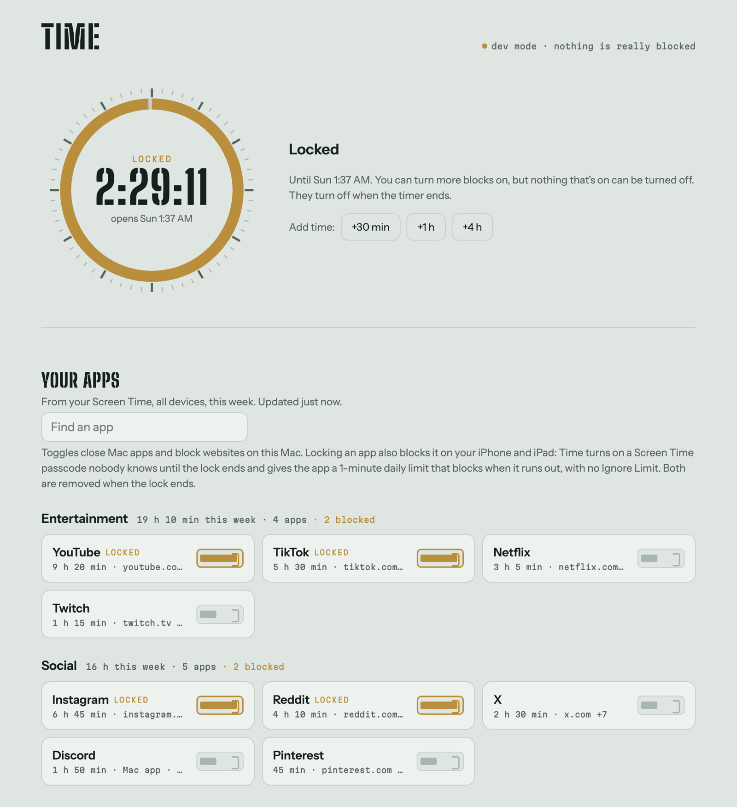

<p align="center">
  
</p>

<h1 align="center">Time</h1>

<p align="center">
  A Mac app and website blocker with a lock timer you can't click past.
</p>

<p align="center">
  <picture>
    <source media="(prefers-color-scheme: dark)" srcset="docs/screenshot-dark.png">
    
  </picture>
  <br>
  <sub>The control page during a lock (dev mode, demo apps).</sub>
</p>

## What it does

- **Lists your apps from Screen Time.** Time reads your Screen Time list (all devices, this week) and groups it by category, so the toggles match the apps you actually use.
- **Toggle a block** to close that app on your Mac and block its websites in every browser.
- **Lock** the blocks that are on for up to 7 days. Until the timer ends they can't be turned off, not by restarting and not by changing the clock.
- **Reaches your iPhone and iPad.** Locking an app also gives it a 1-minute daily Screen Time limit with no "Ignore Limit", behind a passcode nobody knows until the lock ends.
- **Hard mode** (optional, up to 72 hours) takes away your admin rights for the length of the lock.
- **Phone, Messages, and Calendar never lock**, so you can always be reached.

> [!IMPORTANT]
> Time is built to be hard to get out of, and it makes real changes to your Mac: a background service that runs as root, a hidden admin account, your hosts file, and (while a lock runs) your Screen Time settings. [What Time changes on your Mac](#what-time-changes-on-your-mac) lists all of it. Try a short lock before a long one.

## Requirements

- A Mac running **macOS 13 Ventura or later**. Time is developed and tested on macOS 26 Tahoe on Apple silicon.
- An **admin account**. You enter your password once, to install.
- **Xcode Command Line Tools**, to compile the app: `xcode-select --install`
- **Node.js 18 or later** with npm, to build. The background service downloads its own copy of Node, so it doesn't depend on yours.
- **An internet connection** while installing.
- For the Screen Time features: **Screen Time turned on**, and macOS set to **English** (Time finds its way around System Settings by the English labels). To reach your iPhone and iPad, also turn on **Share across devices** and **App Limits** in Screen Time.

## Install

1. **Build the app.**

   ```sh
   git clone https://github.com/ruben-hayrapetyan/Time.git
   cd Time
   ./build-app.sh
   ```

   This compiles Time.app and copies it to `/Applications`, replacing any app there already called Time.

2. **Open Time** from Applications and click **Install**. macOS asks for your password once to set up the background service.

3. **Allow Accessibility access** when macOS asks: System Settings → Privacy & Security → Accessibility → turn on **Time**. Time uses it to read your Screen Time list and to manage limits. Then click **Refresh from Screen Time**.

4. **Wait about a minute** while Time reads Screen Time. System Settings opens out of sight and quits when it's done.

5. **Keep Time running.** It sits in the menu bar with the lock countdown, and it's the part that sets up and removes the iPhone and iPad limits. To keep it running after a restart, add it under System Settings → General → Login Items.

<details>
<summary>Installing without the app</summary>

The same service installs from a terminal:

```sh
sudo ./install.sh
```

The control page is then at **http://localhost:7777** in any browser. Without Time.app you get a built-in list of common apps instead of your Screen Time list, and locks only apply to this Mac.

</details>

## Using Time

**Blocking.** Turn an app's toggle on to block it. Time closes the Mac app whenever it opens and blocks its websites in every browser. An app that's only on your phone shows "not on this Mac"; it gets blocked on the phone once you lock it. Under **Add your own** you can block any Mac app or website. Blocking a site also blocks `www.`, `m.`, and other common versions of it.

**Locking.** Pick a length and click **Lock**. Until the timer ends, nothing that's on can be turned off. You can still turn more blocks on and add time, but you can't take time away. Blocks turn off when the timer ends unless you tick **Keep these blocks on after the timer ends**.

**iPhone and iPad.** When a lock starts, Time.app turns on a random Screen Time passcode and gives each locked app a 1-minute daily App Limit set to **Block at end of limit**. With Share across devices on, those limits apply on your iPhone and iPad too, and getting past one needs the passcode nobody knows. When the lock ends, Time turns the passcode off and removes the limits. It does this by working System Settings for about 30 seconds, either right after you click Lock or once you've left the mouse and keyboard alone for 30 seconds. Don't touch anything while it runs.

**Hard mode.** This is optional for each lock. It needs internet to start and lasts up to 72 hours. Your account leaves the `admin` group until the timer ends, and any open `sudo` or `su` sessions are closed. Your admin rights come back on their own when the lock ends.

**Emergency unlock.** If you really need out, type a 50-word passage by hand. Pasting is off, and it has to take at least 90 seconds. Then wait 20 more minutes with the blocks still on. You can cancel at any point and stay locked.

## How the lock resists being bypassed

1. **No off switch.** While a lock runs, the page and the service both refuse to turn locked blocks off. The lock survives restarts.
2. **Self-protection.** A root service and a watchdog each reload the other if it's stopped, restoring deleted launchd files from a backup. `/etc/hosts` edits get reverted within seconds, and the program files are marked immutable (`chflags schg`).
3. **Clock-proof timer.** The timer gets its time from the [drand](https://drand.love) beacon network (with HTTPS `Date` headers as a fallback) instead of the system clock. Setting the clock forward does nothing. When offline, time only counts while the Mac is awake, so an offline lock can run long but never short.
4. **Emergency unlock only.** The one early way out is the slow, typed emergency unlock described above.
5. **Hard mode.** Without admin rights you can't stop the service or edit its files. A hidden `timekeeper` admin account stays on the Mac as a fallback. Its password is random and [time-lock encrypted](https://github.com/drand/tlock) to the lock's end time, so nobody can read it until then. The service restores your admin rights when the timer ends or the emergency unlock finishes.

**Honest limits.** On your own Mac, determined effort always wins: Recovery Mode, resetting your password through your Apple Account, or (outside hard mode) `sudo` plus enough patience. The goal is to make every way out slower and more deliberate than waiting. The Screen Time features also depend on how System Settings is laid out, so a macOS update can break them until Time catches up. Blocking on the Mac doesn't depend on them.

## Updating

```sh
cd Time
git pull
./build-app.sh
```

Then open Time and click **Update**. Updates wait until no lock is running.

## Uninstalling

In Time's menu, choose **Time → Uninstall Background Service…**, then drag Time.app to the Trash. From a terminal, run `sudo ./uninstall.sh`. Neither works while a lock is running.

If you've locked apps on your iPhone, leave Time.app open for a few minutes after your last lock ends before uninstalling. That gives it time to turn off its Screen Time passcode and remove its limits.

## What Time changes on your Mac

| What | Where | Why |
| --- | --- | --- |
| A background service and a watchdog, run as root | `/Library/LaunchDaemons/com.time.blocker.plist`<br>`/Library/LaunchDaemons/com.time.watchdog.plist` | Enforce blocks and the lock; start at boot |
| Program files, a private copy of Node.js, lock state | `/Library/Application Support/Time` | Marked immutable so they can't be deleted in passing |
| Website blocks | A marked section at the end of `/etc/hosts` | Rewritten every few seconds while blocks are on |
| A hidden admin account, `timekeeper` | Users & Groups (hidden) | Hard mode's fallback admin, with a random, time-locked password |
| A Screen Time passcode and 1-minute App Limits | System Settings → Screen Time | Only while a lock runs; Time.app removes them afterwards |
| Logs | `/Library/Logs/Time.log`<br>`~/Library/Application Support/Time/app.log` | For tracing problems |

The uninstaller removes the service, the program files, the hosts section, and the `timekeeper` account, and makes sure your account is an admin. The log files stay.

**Network and privacy.** Time has no accounts and no analytics, and your app list never leaves your Mac. It connects to:

- the drand beacon network (`api.drand.sh`, `api2.drand.sh`, `drand.cloudflare.com`), for trusted time and time-lock encryption
- `apple.com` and `google.com`, only to read the time from their `Date` header when drand can't be reached
- `nodejs.org`, once, during install
- Google Fonts, for the control page's typefaces

## If something goes wrong

**"Time needs Accessibility access."** Turn Time on in System Settings → Privacy & Security → Accessibility. After a rebuild, macOS may treat Time as a new app: remove it from the list with **−**, add it again, and click Refresh from Screen Time. (See [Development](#development) for a way to stop this.)

**The list shows common apps, not mine.** The Screen Time read hasn't worked yet. Check that Screen Time is on and macOS is in English, then click **Refresh from Screen Time**. In a regular browser the page always shows common apps, so open the Time app instead.

**"Screen Time already has a passcode that Time didn't set."** Time never touches a passcode it didn't set. Either turn yours off in System Settings → Screen Time, or keep it and use Time on the Mac only.

**A blocked website still loads.** Browsers keep their own DNS cache. Quit the browser completely and reopen it.

**The service broke while you were in hard mode, or a Screen Time passcode was left behind.** Once the lock's end time has passed, run:

```sh
"/Library/Application Support/Time/bin/node" "/Library/Application Support/Time/src/recover.js"
```

It prints the `timekeeper` password, the command that makes you an admin again, and any Screen Time passcode Time set. A leftover Screen Time passcode can also be reset with your Apple Account: choose **Forgot Passcode?** when System Settings asks for it.

**Anything else.** Check `/Library/Logs/Time.log` for the service and `~/Library/Application Support/Time/app.log` for the app's Screen Time work.

## Development

```sh
npm install
npm run dev   # http://localhost:7778, dry run: nothing is closed, hosts goes to .dev-state/
```

`./build-app.sh --no-install` builds into `build/` without touching `/Applications`.

By default the app is signed ad hoc, so macOS forgets its Accessibility permission on every rebuild. To keep it, create a self-signed certificate named **Time Local Signing** in Keychain Access (Keychain Access → Certificate Assistant → Create a Certificate…, with Certificate Type set to Code Signing). `build-app.sh` uses it automatically.

| Path | What's there |
| --- | --- |
| `app/` | Time.app in Swift: the window, menu bar countdown, installer, and Screen Time automation |
| `src/` | The background service in Node.js: blocking, the lock timer, hard mode, recovery |
| `ui/` | The control page |
| `install.sh`, `uninstall.sh` | Set up and remove the background service |
| `build-app.sh` | Builds Time.app with the service bundled inside |

## License

[MIT](LICENSE)
